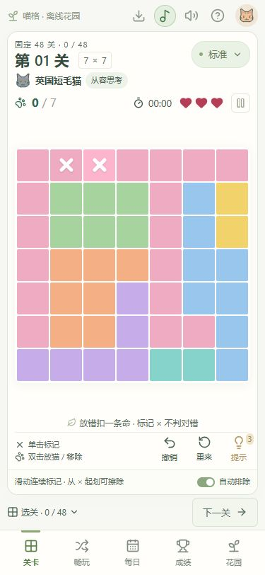
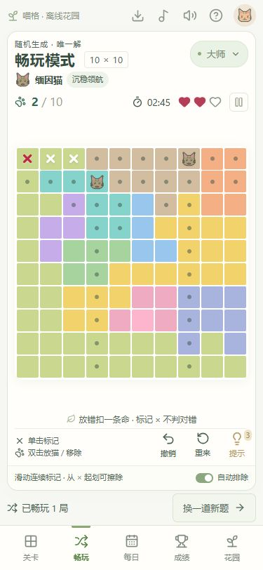
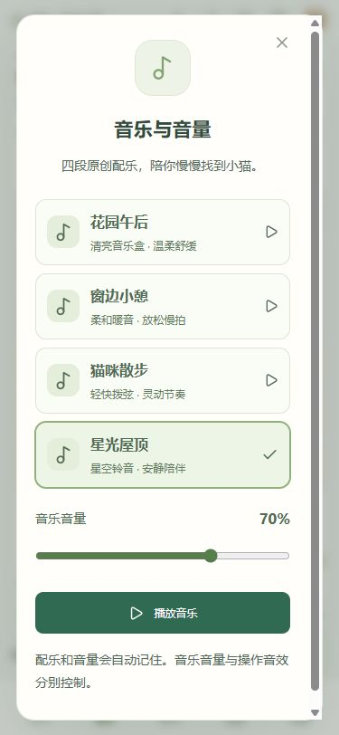

# 喵格

一个轻快的安卓猫咪逻辑小游戏：每行、每列和每个颜色区域各有一只猫，猫咪之间不能相邻。

[下载最新版 APK](https://github.com/QAbot-zh/miaoge/releases/latest/download/miaoge.apk) · [版本记录](https://github.com/QAbot-zh/miaoge/releases)

## 运行截图

  
  
  

标准 7×7 · 大师 10×10 · 离线配乐与音量设置。截图来自游戏实际运行界面。

## 游戏规则

目标是给每只小猫找到唯一的位置，同时满足三条规则：

1. **每行、每列各有一只猫。** 同一行或同一列不能放两只猫。
2. **每个颜色区域各有一只猫。** 同一种颜色属于同一个区域，区域可以是不规则的形状。
3. **猫咪不能相邻。** 一只猫周围的八个格子都不能放其他猫，斜角也算相邻。

所有小猫都正确就位后即可通关。每道题都有唯一解，可以通过颜色区域、行列和相邻限制逐步推理。

### 手机操作

| 操作 | 效果 |
| --- | --- |
| 单击格子 | 添加或擦除白叉，表示自己认为这里没有猫；不判对错、不扣生命 |
| 双击格子 | 放入小猫，或移除已放的小猫 |
| 在棋盘上滑动 | 连续添加白叉；从已有白叉开始滑动则连续擦除，跳过已有小猫和红叉 |
| 撤销 | 撤回上一步棋盘操作，一次滑动可以一步撤销 |
| 提示 | 每局最多三次，确认一只猫的位置；使用次数会计入成绩 |
| 自动排除 | 用圆点提示与已放小猫冲突的位置，辅助推理 |

**每局有三条生命。** 放错小猫会扣一条生命，并在该位置留下粗圆角红叉。红叉表示已经确认的错误位置，不能被撤销或滑动擦除；移除小猫、撤销和重新打开游戏都不会返还已扣的生命。重新开始或换题后恢复生命并清除红叉。

### 难度与模式

| 难度 | 棋盘 | 猫咪伙伴 |
| --- | --- | --- |
| 轻松 | 6×6 · 7 关 | 布偶猫 |
| 标准 | 7×7 · 48 关 | 英国短毛猫 |
| 困难 | 8×8 · 60 关 | 暹罗猫 |
| 专家 | 9×9 · 60 关 | 孟加拉猫 |
| 大师 | 10×10 · 60 关 | 缅因猫 |

- **关卡模式**：共 235 道固定新题。棋盘区域和小猫答案均排除旋转、镜像重复，也避开旧版内置题的答案形态。完成一种难度的全部关卡，点亮对应通关徽章；完成全部 235 关，获得全关卡通关成就。通关后不会自动循环增加关卡。已完成关卡可以主动重玩。
- **每日挑战**：按手机的北京时间日期本地生成，每天一题，离线也能玩。
- **畅玩模式**：根据难度生成新的随机关卡，随时开启下一题。
- **个人成绩**：按模式和难度展示最高的十次成绩，记录保存在手机。

## 安装与更新

支持 Android 7.0 及以上。第一次在手机浏览器中打开上面的下载链接，下载 APK 后按安卓提示安装。

已安装旧版喵格时，直接覆盖安装即可保留进度与个人成绩；请不要先卸载。

从 1.3 版开始，点击游戏顶部的下载图标进入「应用更新」：检查版本 → 下载更新 → 安装更新。首次通过喵格安装更新时，安卓可能要求允许喵格安装应用；完成设置后返回喵格，点击「继续安装」。每次覆盖安装都需要安卓系统确认。

新版题库与旧版不同，通关进度单独记录。旧版完成记录归档保留，旧成绩继续保存在花园；未完成的旧题可以继续或重来，完成后可进入新版题库。

只有手动检查、下载更新时需要网络。游戏、内置关卡、随机出题、每日挑战、配乐和个人成绩均可离线使用。存档保存在手机，卸载或清除数据会删除存档。

## 轻快的小体验

- 七首内置配乐：罐头派对、猫猫蹦迪、纸箱冲刺，以及四首舒缓曲目。欢快、动感、激动节奏均可选择，曲目和音量会自动记住。
- 顶部喇叭一键静音音乐与音效，再点一次恢复。配乐音符与伴奏经过响度调整，持续部分更饱满。
- 花园中的「本地记录与重置」可只清游戏记录并保留个人设置，也可恢复初始状态；清理前需要确认。
- 放猫和标记有缩放回弹与操作音效，通关和失败有各自的短音效。
- 通关后送上一句猫咪语录，陪你开启下一场小冒险。
- 暂停、切到后台和关闭游戏期间不计时，重新打开可接着上次的一局。

本仓库提供游戏介绍、运行截图和 APK，不包含游戏源码、签名密钥或玩家数据。

<!-- miaoge-release {"version":"1.5","versionCode":6,"sha256":"559073b6ced3265defec8854a13a37af168fe148e3cbc7797f928160c59ae408","size":3348083} -->
